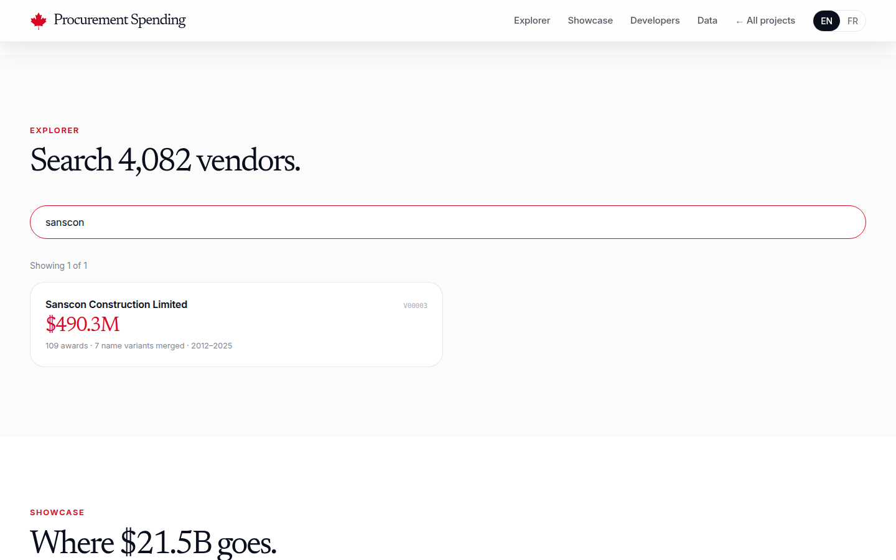
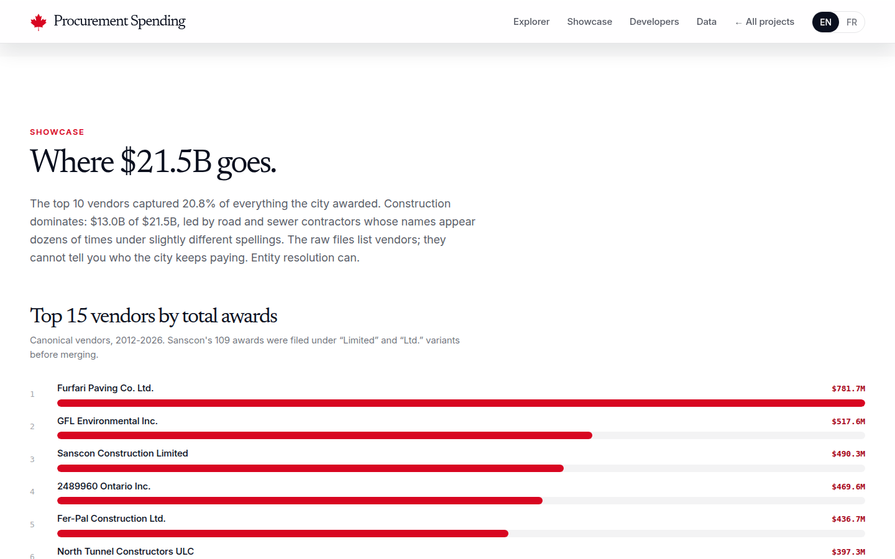

# toronto-procurement-spending

Who gets the city's money: Toronto's $21.5B in awarded contracts and consulting spend (2012-2026), resolved to 4,082 canonical vendors. Nshipyard Canada project 09.

Toronto publishes every awarded contract, but the same vendor hides behind 4,240 different spellings ("Sanscon Construction Limited" vs "Sanscon Construction Ltd."), and three award values in the source file are phone numbers typed into the amount field. This project is the cleanup: deterministic vendor entity resolution into canonical vendor IDs, quarantine of the defective records, and spend aggregates by year, category, division, and competitive status.

An open-source civic project. Not affiliated with the Government of Canada or the City of Toronto.

## Screenshots





## What the data shows

- $21.5B across 13,084 award records, resolved to 4,082 canonical vendors from 4,240 raw name spellings (174 fuzzy merges, all logged in `data/vendor_merges.json`).
- The top 10 vendors captured 20.8% of all spend. The largest is Furfari Paving Co. Ltd. at $781.7M across 58 awards.
- 90.1% of spend went through open competition ($19.4B). Non-competitive awards are 8.5% ($1.8B across 2,887 contracts); emergencies lead the stated reasons at $450M, followed by exclusive rights at $417M.
- Construction Services dominate at $13.0B, 60% of the total. Tenders (RFT) are the main solicitation type at $12.4B.
- 72 vendors won 21 or more awards each; 2,268 vendors won exactly once.
- Three source records carried bare 10-digit integers in the amount field (9054510208, 4163927134, 1898820680), the pattern of phone numbers rather than credible awards. They are quarantined and excluded from every total; without this the headline spend would be overstated by $15.1B.

## Files

- `data/summary.json` - spend aggregates: by year, kind, category, division, non-competitive reason, RFx type, top 25 vendors, repeat-winner buckets, methodology notes
- `data/vendors_index.json` - the 4,082 canonical vendors (id, name, variant count, awards, spend, years, categories)
- `data/awards_index.json` - trimmed award records with canonical vendor IDs
- `data/vendor_variants.csv` - the entity-resolution table: 4,240 raw spellings mapped to canonical vendor IDs
- `data/vendor_merges.json` - the 174 fuzzy merges, logged for audit
- `data/raw/` - source files from the City of Toronto CKAN (not committed)
- `scripts/build_data.py` - the full reproducible pipeline

## Methodology

Sources: three City of Toronto open-data packages retrieved 2026-10-08 from the CKAN datastore: "Toronto Bids Awarded Contracts" (7,755 records), "Toronto Bids Non-Competitive Contracts" (2,937), and "Consulting Services Expenditures" 2012-2024 (3,187 rows). Entity resolution: uppercase, strip punctuation, drop 15 legal suffixes, exact match, then a fuzzy pass (difflib ratio 0.93 or higher with a shared first token, union-find). Toronto publishes no commodity codes on award records, so High Level Category is the source's own coarse coding and GSIN hints are keyword heuristics with 1.8% coverage, suggestion-only. Amounts are award values as published, not audited payments; multi-year awards appear in full in the award year. Build script: `scripts/build_data.py`.

## Develop

```bash
npm install
npm run dev
```

## API

REST under `/api/v1/`:

- `GET /api/v1/vendor/search?q=furfari&limit=50` - search canonical vendors by name, ranked by total spend
- `GET /api/v1/vendor/lookup?vendor_id=V00001` - full vendor record: spend, awards, merged name variants, top awards
- `GET /api/v1/spend/summary` - spend aggregates by year, kind, category, division, non-competitive reason, RFx type

OpenAPI 3.1 spec at `/api/openapi.json`.

MCP (streamable HTTP, JSON-RPC 2.0): `POST /mcp` with tools `vendor_lookup`, `vendor_search`, `spend_summary`.

## Author

**Richardson Dackam** - [X (@richardsondx)](https://x.com/richardsondx) · [GitHub](https://github.com/richardsondx)

## License

MIT. Award records are © City of Toronto (open data); the vendor entity resolution is original work.
